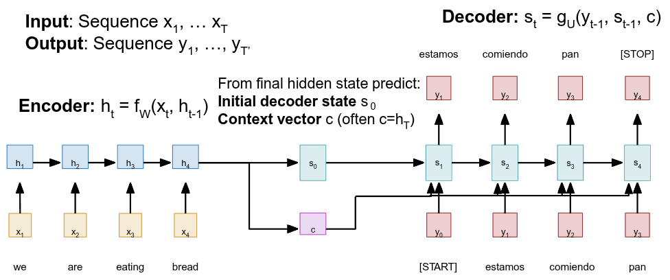

## 1. Recurrent Sequence Models and the Sequence-to-Sequence Bottleneck

Sequence-to-Sequence (Seq2Seq) architectures powered by Recurrent Neural Networks (RNNs) established the foundational paradigm for early neural machine translation (NMT) and sequence modeling. Prior to these architectures, mapping variable-length input sequences to variable-length output sequences posed a structural challenge for fixed-input neural networks. The classic Seq2Seq paradigm resolved this by partitioning the task into two recurrent sub-networks: an _Encoder_ that ingests the input sequence and a _Decoder_ that autoregressively generates the target sequence. Understanding the structural limitations of standard encoder-decoder RNNs is essential to appreciating the paradigm shift toward attention-driven architectures.



### 1.1 Mathematical Formulation of Classical Seq2Seq

Given an input sequence $X = (x_1, x_2, \dots, x_T)$ of length $T$ and a target sequence $Y = (y_1, y_2, \dots, y_{T'})$ of length $T'$ (where sequence lengths $T$ and $T'$ frequently differ), the recurrent encoder processes tokens sequentially. At each time step $t \in \{1, \dots, T\}$, the encoder updates its internal hidden state $h_t \in \mathbb{R}^d$ via a non-linear activation function $f_W$ parameterized by learnable weight matrices $W$:

$$h_t = f_W(x_t, h_{t-1})$$

The recurrence operates step-by-step from $t = 1$ to $t = T$, initialized from $h_0 = \mathbf{0}$. Upon reading the terminal input token $x_T$, the encoder produces its final hidden state $h_T$. In standard Seq2Seq models (e.g., Sutskever et al., 2014), this terminal state $h_T$ serves two distinct functions:

1. It initializes the decoder's hidden state: $s_0 = h_T$.
2. It forms a static context vector $c$ (where $c = h_T$) passed to the decoder at every output time step.

The decoder generates the target sequence autoregressively using a recurrence function $g_U$:

$$s_t = g_U(y_{t-1}, s_{t-1}, c)$$

where $s_t \in \mathbb{R}^d$ represents the decoder's state at output step $t$, $y_{t-1}$ is the previously generated token (initialized with a special `[START]` token $y_0$), and $c$ remains fixed throughout decoding until a terminal `[STOP]` token is predicted.

### 1.2 The Information Compression Bottleneck

The structural flaw in this classic framework lies in forcing the context vector $c$ to be a single, fixed-size vector (e.g., $c \in \mathbb{R}^d$). As the input sequence length $T$ scales—such as processing a document of $T=1000$ tokens—the network must compress all semantic, syntactic, and long-range dependencies into this single vector representation.

Mathematically, $c$ acts as an information bottleneck. Compressing an arbitrary number of tokens into a fixed-dimensional vector space creates theoretical and practical degradation:

- **Loss of Long-Range Dependencies:** As backpropagation through time (BPTT) executes over long sequences, information from early tokens ($x_1, x_2$) is diluted or overwritten by later tokens ($x_{T-1}, x_T$).
- **Vanishing Gradients:** Error gradients propagated from the decoder back to early encoder states decay exponentially over sequence steps, preventing early input tokens from receiving meaningful weight updates.
- **Degraded Translation Quality:** Empirical performance degrades rapidly as sequence length grows beyond a few dozen tokens, as the static vector $c$ fails to retain fine-grained contextual details needed for downstream generation.

### 1.3 Capacity Constraints: Theory vs. Practice

- **Theoretical Capacity:**
    - In principle, high-dimensional hidden states $h_t$ can model arbitrary temporal relationships.
    - Recurrent feedback loops allow unbounded sequence processing over time steps $t$.
    - Fixed-size vectors theoretically store complex language semantics when fully optimized.
- **Practical Failures:**
    - Severe information loss occurs when compressing long input sequences ($T \ge 1000$) into a single static context vector $c$.
    - Sequential BPTT causes vanishing gradients, cutting off early tokens from learning long-distance relationships.
    - Inability to retrieve specific historical input details leads to structural errors and missing context in outputs.

To bypass this single-vector compression bottleneck, architectures required a dynamic lookup mechanism to selectively access intermediate encoder hidden states during decoding, directly catalyzing the development of additive attention mechanisms.

---

## 2. Additive Attention Mechanisms (Bahdanau Attention)

Additive attention (Bahdanau et al., 2015) replaced the static context vector $c$ with a dynamic alignment mechanism. Instead of forcing the encoder to compress the entire input sequence into a single terminal state $h_T$, the model retains all intermediate encoder states $(h_1, h_2, \dots, h_T)$. During each step of decoding, the decoder calculates a unique context vector $c_t$ by dynamically evaluating which input hidden states are most relevant to generating the next output token.


### 2.1 Mathematical Formulation and Recurrent Causality

The step-by-step computation of Bahdanau additive attention proceeds as follows:

1. **Alignment Score Calculation:** Before generating target token $y_t$, the decoder compares its _previous_ hidden state $s_{t-1}$ against every encoder hidden state $h_i$ (for $i = 1, \dots, T$). The scalar alignment score $e_{t,i} \in \mathbb{R}$ quantifies the relevance between input position $i$ and output position $t$: $$e_{t,i} = f_{\text{att}}(s_{t-1}, h_i) = v_a^T \tanh(W_a s_{t-1} + U_a h_i)$$ Here, $f_{\text{att}}$ is parameterized as a learnable Multi-Layer Perceptron (MLP) with weight matrices $W_a, U_a$ and projection vector $v_a$, trained end-to-end via backpropagation.

	_Crucial Timing Distinction:_ The alignment score $e_{t,i}$ explicitly depends on $s_{t-1}$—the decoder state _before_ emitting token $y_t$. This timing maintains strict recurrent causality: $s_{t-1}$ encodes the history of generated tokens $(y_0, \dots, y_{t-1})$ to determine where to attend next, before $s_t$ is updated.

2. **Attention Weight Normalization via Softmax:** The raw alignment scores $e_{t,i}$ are normalized using a Softmax function across all input sequence steps $i$: $$a_{t,i} = \frac{\exp(e_{t,i})}{\sum_{k=1}^{T} \exp(e_{t,k})}$$ This guarantees $0 < a_{t,i} < 1$ and $\sum_{i=1}^{T} a_{t,i} = 1$, allowing $a_{t,i}$ to act as a probability distribution over the input states.
3. **Dynamic Context Vector Computation:** The dynamic context vector $c_t \in \mathbb{R}^d$ is computed as a weighted sum of all encoder hidden states $h_i$: $$c_t = \sum_{i=1}^{T} a_{t,i} h_i$$
4. **Decoder State Update:** The decoder updates its state $s_t$ using the previously generated token $y_{t-1}$, previous state $s_{t-1}$, and current dynamic context vector $c_t$: $$s_t = g_U(y_{t-1}, s_{t-1}, c_t)$$


### 2.2 Interpretability and Machine Translation

By plotting the attention weights $a_{t,i}$ as an $T' \times T$ matrix, we can visualize soft alignments between source and target words.

For example, when translating the English sequence _"we are eating bread"_ ($x_1 \dots x_4$) into the Spanish sequence _"estamos comiendo pan"_ ($y_1 \dots y_3$):

- To generate $y_1 =$ _"estamos"_ (which synthesizes _"we are"_), the decoder assigns high attention weights to $h_1$ and $h_2$ ($a_{1,1} \approx 0.45, a_{1,2} \approx 0.45$), and low weights to $h_3$ and $h_4$ ($a_{1,3} \approx 0.05, a_{1,4} \approx 0.05$).
- To generate $y_2 =$ _"comiendo"_ (_"eating"_), attention shifts dynamically to $h_3$ ($a_{2,3} \approx 0.80$).

```
                SOURCE TOKENS (i)
               we    are   eating  bread
             ----------------------------
y1: estamos | 0.45  0.45   0.05    0.05
y2: comiendo| 0.05  0.05   0.80    0.10
y3: pan     | 0.02  0.03   0.05    0.90
```

These alignment matrices reveal structural language differences without hand-crafted syntactic rules. In English-to-French translation, English places adjectives before nouns (_"European Economic Area"_), whereas French places adjectives after nouns (_"Zone économique européenne"_). The alignment matrix captures this non-linear word reordering through non-diagonal high-activation clusters. Because all attention operations are differentiable, the network learns these soft alignments end-to-end without explicit alignment supervision.


### 2.3 Visual Attention in Image Captioning

The attention mechanism extends to spatial grid structures in computer vision ("Show, Attend and Tell", Xu et al., 2015). Instead of 1D temporal hidden states, a Convolutional Neural Network (CNN) backbone extracts a 3D feature grid $Z \in \mathbb{R}^{H \times W \times D}$ from an input image, where $H \times W$ denotes spatial grid coordinates and $D$ represents feature channel depth.


The decoder RNN computes spatial alignment scores across grid coordinates $(i, j)$ for $i \in \{1, \dots, H\}$ and $j \in \{1, \dots, W\}$:

$$e_{t,i,j} = f_{\text{att}}(s_{t-1}, z_{i,j})$$

_Spatial Grid Normalization:_ Unlike 1D sequence attention normalized over length $T$, visual attention normalizes simultaneously across all $H \cdot W$ spatial grid patches:

$$a_{t,i,j} = \frac{\exp(e_{t,i,j})}{\sum_{i'=1}^{H} \sum_{j'=1}^{W} \exp(e_{t,i',j'})}, \quad \text{where } \sum_{i=1}^{H} \sum_{j=1}^{W} a_{t,i,j} = 1$$


### 2.4 Computational Cost and Memory Analysis

While additive attention resolves the single-vector bottleneck, it introduces operational trade-offs:

- **Computational Overhead ($O(T \cdot T')$):** Calculating alignment scores requires comparing every output time step $T'$ with every input time step $T$. This pairwise calculation scales quadratically with sequence length, compared to the linear $O(T + T')$ cost of standard recurrent models.
- **Memory Retention Overhead:** The model cannot discard intermediate encoder states $h_i$ after reading the input. All $T$ vectors ($h_i \in \mathbb{R}^d$) must be cached in VRAM during decoding.

While Bahdanau attention allowed decoders to selectively query encoder states, processing tokens still required sequential RNN loops step-by-step. To scale sequence models further, architectures needed an attention mechanism that could eliminate recurrent hidden states entirely.

---

## 3. Self-Attention and the Query-Key-Value (QKV) Framework

Self-attention eliminates recurrent loops entirely, allowing every token in a sequence to interact directly with every other token in a single computational step. By computing pairwise interactions across all positions in a sequence, self-attention converts static token embeddings into contextualized representations that encode syntax, coreference, and semantic relationships.


### 3.1 The Query-Key-Value (QKV) Abstraction and Tensor Shape Mechanics

The QKV framework structures sequence interaction using a database lookup metaphor. Let $B$ represent batch size, $S$ represent sequence length, $d_{\text{model}}$ represent model feature dimension, $d_k$ represent Key/Query projection dimension, and $d_v$ represent Value projection dimension.

Given an input tensor $X \in \mathbb{R}^{B \times S \times d_{\text{model}}}$, the model projects each token into three vector spaces using learnable parameter matrices $W_Q \in \mathbb{R}^{d_{\text{model}} \times d_k}$, $W_K \in \mathbb{R}^{d_{\text{model}} \times d_k}$, and $W_V \in \mathbb{R}^{d_{\text{model}} \times d_v}$:

$$Q = X W_Q \in \mathbb{R}^{B \times S \times d_k}$$

$$K = X W_K \in \mathbb{R}^{B \times S \times d_k}$$

$$V = X W_V \in \mathbb{R}^{B \times S \times d_v}$$

|Representation|Mathematical Definition|Intuitive Metaphor|
|---|---|---|
|**Query (**$Q$**)**|$Q = X W_Q \in \mathbb{R}^{B \times S \times d_k}$|The target focus seeking context. Represents what the current token is searching for among other tokens in the sequence.|
|**Key (**$K$**)**|$K = X W_K \in \mathbb{R}^{B \times S \times d_k}$|The index tag for each token. Represents the attributes offered by candidate tokens to match incoming queries.|
|**Value (**$V$**)**|$V = X W_V \in \mathbb{R}^{B \times S \times d_v}$|The underlying content vector. Contains the semantic information extracted and aggregated when a query matches a key.|

### 2.2 Mathematical Derivation of Scaled Dot-Product Attention

The dot product $Q K^T$ calculates raw similarity scores between every query $q_i$ and key $k_j$. To maintain stable gradients during backpropagation, the product is divided by a scaling factor $\sqrt{d_k}$.

_Derivation of Variance Scaling_ $\frac{1}{\sqrt{d_k}}$_:_ Assume components of $q_i \in \mathbb{R}^{d_k}$ and $k_j \in \mathbb{R}^{d_k}$ are independent random variables with zero mean ($\mathbb{E}[q_{i,m}] = \mathbb{E}[k_{j,m}] = 0$) and unit variance ($\text{Var}(q_{i,m}) = \text{Var}(k_{j,m}) = 1$). Their dot product is $q_i \cdot k_j = \sum_{m=1}^{d_k} q_{i,m} k_{j,m}$. The expectation of the sum is 0, and its variance is:

$$\text{Var}\left(\sum_{m=1}^{d_k} q_{i,m} k_{j,m}\right) = \sum_{m=1}^{d_k} \text{Var}(q_{i,m} k_{j,m}) = \sum_{m=1}^{d_k} \mathbb{E}[q_{i,m}^2] \mathbb{E}[k_{j,m}^2] = \sum_{m=1}^{d_k} (1)(1) = d_k$$

For large $d_k$, the dot product variance grows to $d_k$, pushing dot products to large magnitude values. This drives the Softmax function into saturation regions where gradients vanish ($\nabla \text{softmax} \approx \mathbf{0}$). Dividing $Q K^T$ by $\sqrt{d_k}$ scales the variance back to $1.0$, stabilizing backpropagation.

The full Scaled Dot-Product Attention equation is:

$$\text{Attention}(Q, K, V) = \text{softmax}\left(\frac{Q K^T}{\sqrt{d_k}}\right) V$$

### 2.3 Tensor Evolution Step-by-Step:

1. **Similarity Matrix (**$Q K^T \in \mathbb{R}^{B \times S \times S}$**):** Pairwise matrix multiplication comparing all queries and keys in parallel.
2. **Variance Scaling (**$\frac{Q K^T}{\sqrt{d_k}} \in \mathbb{R}^{B \times S \times S}$**):** Divides matrix elements by $\sqrt{d_k}$ to prevent Softmax saturation.
3. **Softmax Normalization (**$A = \text{softmax}\left(\frac{Q K^T}{\sqrt{d_k}}\right) \in \mathbb{R}^{B \times S \times S}$**):** Applied row-wise across the last dimension, producing normalized weights where $\sum_{j=1}^{S} A_{b,i,j} = 1$.
4. **Contextual Aggregation (**$A V \in \mathbb{R}^{B \times S \times d_v}$**):** Multiplies attention weights $A$ by the Value tensor $V$. Each token representation becomes a weighted sum of all Value vectors in the sequence.

> [!Quote]- **Professor's Architectural Note**
> Modern AI hardware accelerators (e.g., NVIDIA Tensor Cores) are optimized for dense matrix-matrix multiplication ($Q K^T$) rather than sequential vector-matrix operations found in RNNs. By formulating sequence interactions as a unified matrix operation, self-attention transforms sequence modeling from a memory-bandwidth-bound sequential loop into a compute-bound operation that executes efficiently on parallel hardware architectures.

### 2.4 Contextual Integration and Ambiguity Resolution

Self-attention allows tokens to dynamically update their representations based on surrounding context. Consider the sentence: _"The animal didn't cross the street because it was too tired."_

To resolve the ambiguous pronoun _"it"_, the Query vector for _"it"_ calculates dot products against Key vectors for all preceding tokens. The Key vector for _"animal"_ yields a significantly higher dot product than _"street"_. Consequently, the Softmax row for _"it"_ assigns a high weight to _"animal"_, pulling its Value vector into the output state for _"it"_, resolving the coreference link.

Similarly, self-attention resolves polysemous words (words with multiple meanings). For example, the standalone word _"eating"_ has a generic embedding, but when self-attention processes _"eating bread"_, the token _"eating"_ attends to _"bread"_, incorporating specific context into its updated value vector.

While QKV self-attention models rich semantic dependencies across a sequence, it treats input vectors as an unordered set. Because dot-product attention contains no inherent structural bias for token position, pure self-attention is insensitive to sequence order.

---

## 4. Positional Encoding and Causal (Masked) Self-Attention

### 4.1 Permutation Equivariance Analysis

A pure self-attention layer is _permutation equivariant_. If $\mathcal{P}(\cdot)$ represents a permutation operator that shuffles sequence tokens along the length dimension, applying self-attention to a permuted sequence produces an output permuted by the exact same operator:

$$\text{Attention}(\mathcal{P}(X)) = \mathcal{P}(\text{Attention}(X))$$

Because matrix multiplication ($Q K^T$) processes pairwise token interactions independently of sequence position, swapping word positions changes output order but leaves calculated contextual values unchanged for those words.

In natural language processing, this order-insensitivity is a limitation: the sequence _"A person riding a horse"_ produces identical contextual representation vectors to _"A horse riding a person"_, despite having opposite meanings. To provide awareness of word order without using sequential recurrence, explicit positional metadata must be injected into input token embeddings.

### 4.2 Functional Constraints for Positional Representations

To encode positional metadata into a Transformer, a positional encoding function $PE: \mathbb{N} \to \mathbb{R}^{d_{\text{model}}}$ must satisfy four core functional requirements:

1. **Unique Identity:** It must generate a unique positional vector for every time-step $pos$ in a sequence.
2. **Bounded and Deterministic Values:** It must produce deterministic outputs with bounded values to keep activations stable during training.
3. **Distance Consistency:** The distance metric between encodings at relative positions ($pos$ and $pos + \Delta t$) must remain consistent across variable sentence lengths.
4. **Generalization:** It must generalize smoothly to longer sequence lengths than those encountered during training.

### 4.3 Sinusoidal Positional Encoding Mechanics

Vaswani et al. (2017) introduced a deterministic sinusoidal positional encoding function using varying frequency sine and cosine functions across embedding dimensions:

$$\text{PE}_{(pos, 2k)} = \sin\left(\frac{pos}{10000^{2k/d_{\text{model}}}}\right)$$

$$\text{PE}_{(pos, 2k+1)} = \cos\left(\frac{pos}{10000^{2k/d_{\text{model}}}}\right)$$

where $pos \in \{0, 1, \dots, S-1\}$ represents absolute token position, and $k \in [0, d_{\text{model}}/2)$ indexes the embedding channel pair.


#### The Binary Counter Analogy

This sinusoidal formulation operates similarly to a continuous binary counter. Low channel dimensions ($k \to 0$) use high-frequency sinusoids that oscillate rapidly across adjacent positions $pos$, capturing fine-grained local positional relationships. High channel dimensions ($k \to d_{\text{model}}/2$) use low-frequency sinusoids with wavelengths up to $10000 \cdot 2\pi$, providing spatial tracking across long sequences.

```
Bit 0 (Fastest): 0 1 0 1 0 1 0 1  <-- High Frequency (Local spatial position)
Bit 1          : 0 0 1 1 0 0 1 1
Bit 2 (Slowest): 0 0 0 0 1 1 1 1  <-- Low Frequency (Global spatial position)
```

#### Mathematical Proof of the Linear Projection Property

A key property of sinusoidal encodings is that for any fixed offset $\Delta t$, the encoding at position $pos + \Delta t$ can be represented as a linear projection of the encoding at position $pos$.

_Proof:_ Let $\omega_k = \frac{1}{10000^{2k/d_{\text{model}}}}$. Applying the trigonometric angle addition formulas for sine and cosine gives:

$$\text{PE}_{(pos+\Delta t, 2k)} = \sin(\omega_k (pos + \Delta t)) = \sin(\omega_k pos)\cos(\omega_k \Delta t) + \cos(\omega_k pos)\sin(\omega_k \Delta t)$$

$$\text{PE}_{(pos+\Delta t, 2k+1)} = \cos(\omega_k (pos + \Delta t)) = \cos(\omega_k pos)\cos(\omega_k \Delta t) - \sin(\omega_k pos)\sin(\omega_k \Delta t)$$

Expressed in matrix form, there exists a linear rotation matrix $M_{\Delta t} \in \mathbb{R}^{2 \times 2}$ such that:

$$\begin{bmatrix} \text{PE}_{(pos+\Delta t, 2k)} \\ \text{PE}_{(pos+\Delta t, 2k+1)} \end{bmatrix} = \begin{bmatrix} \cos(\omega_k \Delta t) & \sin(\omega_k \Delta t) \\ -\sin(\omega_k \Delta t) & \cos(\omega_k \Delta t) \end{bmatrix} \begin{bmatrix} \text{PE}_{(pos, 2k)} \\ \text{PE}_{(pos, 2k+1)} \end{bmatrix}$$

Because $M_{\Delta t}$ depends only on relative offset $\Delta t$ and not on absolute position $pos$, linear layers in self-attention can learn relative distance relationships across sequence positions.

The positional vector $\text{PE}_{(pos)}$ is added directly to the input token embedding $X_{(pos)}$ before entering the network:

$$\tilde{X}_{(pos)} = X_{(pos)} + \text{PE}_{(pos)}$$

### Causal (Masked) Self-Attention

In bidirectional encoders, self-attention allows tokens to attend both forward and backward across a sequence. However, autoregressive generation requires that generating token $y_t$ depends _only_ on previously generated tokens $(y_0, \dots, y_{t-1})$. Attending to future tokens $(y_{t+1}, \dots, y_T)$ would allow the model to copy target answers directly during training.

To enforce causal autoregression, decoders use **Causal (Masked) Self-Attention**. Future token positions are masked out by setting their raw alignment scores to $-\infty$ prior to Softmax:

$$M_{i,j} = \begin{cases} 0 & \text{if } i \ge j \\ -\infty & \text{if } i < j \end{cases}$$

$$\text{MaskedAttention}(Q, K, V) = \text{softmax}\left(\frac{Q K^T}{\sqrt{d_k}} + M\right) V$$


Because $\exp(-\infty) = 0$, Softmax assigns zero attention weight to future token positions ($j > i$). This enforces causality during parallelized training while preserving matrix multiplication speed benefits.

Integrating positional encodings and causal masking into the Transformer block forms the full network architecture.

---

## 5. The Complete Transformer Architecture and Multi-Head Attention

The Transformer architecture (Vaswani et al., 2017) synthesizes self-attention, positional encodings, multi-head abstractions, and feed-forward subnetworks into a modular, parallel processing model.


### 5.1 Multi-Head Attention (MHA)

Single-head attention computes a single average attention distribution across a sequence, which can average out distinct relationship types. For instance, a token may need to attend to syntactic dependencies, coreference links, and local positional context simultaneously.

Multi-Head Attention (MHA) splits the feature space into $h$ lower-dimensional subspaces (typically $h=8$). Each "head" projects inputs using independent parameter matrices $W_Q^{(i)} \in \mathbb{R}^{d_{\text{model}} \times d_k}$, $W_K^{(i)} \in \mathbb{R}^{d_{\text{model}} \times d_k}$, $W_V^{(i)} \in \mathbb{R}^{d_{\text{model}} \times d_v}$ (where $d_k = d_v = d_{\text{model}} / h$):

$$\text{head}_i = \text{Attention}\left(X W_Q^{(i)}, X W_K^{(i)}, X W_V^{(i)}\right) \in \mathbb{R}^{B \times S \times d_v}$$

$$\text{MultiHead}(Q, K, V) = \text{Concat}(\text{head}_1, \text{head}_2, \dots, \text{head}_h) W^O \in \mathbb{R}^{B \times S \times d_{\text{model}}}$$

where $W^O \in \mathbb{R}^{(h \cdot d_v) \times d_{\text{model}}}$ projects the concatenated multi-head outputs back into the hidden dimension. This structure enables individual heads to specialize—one head might track syntactic agreement, another coreferences, and a third local positional context (similar idea as multiple conv filters in a layer).


### 5.2 Encoder and Decoder Layer Structure

The canonical Transformer stacks $N=6$ identical encoder blocks and $N=6$ identical decoder blocks.

#### Encoder Layer Sub-Blocks:

1. **Multi-Head Bidirectional Self-Attention:** Computes pairwise attention across all input sequence tokens.
2. **Position-wise Feed-Forward Network (FFN):** A two-layer token-level MLP applied independently to each position: $$\text{FFN}(x) = \max(0, x W_1 + b_1) W_2 + b_2$$

Both sub-layers use a residual connection ($x + \text{Sublayer}(x)$) followed by Layer Normalization ($\text{LayerNorm}$).


#### Decoder Layer Sub-Blocks:

1. **Masked Multi-Head Self-Attention:** Restricts decoder tokens to attending only to present and past output positions $j \le i$.
2. **Encoder-Decoder Cross-Attention:** Uses Queries ($Q$) generated by the decoder's masked self-attention layer, while drawing Keys ($K$) and Values ($V$) directly from the output of the Encoder stack. This allows the decoder to access source context at every generation step.
3. **Position-wise Feed-Forward Network (FFN):** Applies token-level non-linear transformations identical to the encoder FFN.
   


>[!Quote]- **Professor's Architectural Note**
> In the original Transformer (Vaswani et al., 2017), Layer Normalization was placed _after_ the residual addition ($\text{Post-LN}$): $\text{LayerNorm}(x + \text{Sublayer}(x))$. However, in deep networks ($N > 12$), Post-LN causes gradient magnitudes near the output layer to grow large relative to early layers, making warmup schedules necessary. Modern implementations use $\text{Pre-LN}$: $x + \text{Sublayer}(\text{LayerNorm}(x))$, where gradients flow directly through the residual skip pathway, improving training stability in deep models.

### 5.3 Comparative Paradigm Analysis

|Parameter / Metric|Recurrent Neural Networks (RNN)|Convolutional Neural Networks (CNN)|Self-Attention (Transformer)|
|---|---|---|---|
|**Computational Complexity per Layer**|$O(S \cdot d^2)$|$O(k \cdot S \cdot d^2)$|$O(S^2 \cdot d)$|
|**Sequential Operations (Parallelizability)**|$O(S)$ (Sequential processing loop over step $t$)|$O(1)$ (Parallel execution across spatial grids)|$O(1)$ (Parallel execution across all token pairs)|
|**Maximum Path Length Between Tokens**|$O(S)$ (Information passes step-by-step through intermediate hidden states)|$O(\log_k(S))$ (Requires stacking multi-layer convolutional trees)|$O(1)$ (Direct pairwise comparisons connect all token pairs)|
|**Structural Inductive Bias**|**High:** Strong temporal sequential bias (assumes adjacent order step-by-step)|**High:** Strong spatial locality and translation invariance|**Minimal:** Zero structural spatial/temporal bias (relies on positional encodings)|
|**Inference Memory Consumption (KV Cache)**|$O(d)$ (Maintains a single recurrent state vector $h_t \in \mathbb{R}^d$)|$O(k \cdot d)$ (Maintains receptive field sliding window buffer)|$O(S \cdot d)$ (Caches historical Key and Value tensors for all tokens)|

_Note:_ $S$ _denotes sequence length,_ $d$ _denotes feature representation dimension, and_ $k$ _denotes convolutional kernel size._

#### Scaling Laws and the Parallelization Imperative

While self-attention incurs quadratic computational complexity $O(S^2 \cdot d)$ per layer with respect to sequence length $S$, it reduces sequential operations to $O(1)$.

Traditional RNNs require sequential step-by-step loops ($O(S)$), preventing parallel execution during forward passes or backpropagation. In contrast, Transformers eliminate hidden-state temporal dependencies, allowing GPU clusters to process thousands of tokens in parallel.

This operational efficiency unlocked **Scaling Laws** in deep learning: models scaled from millions to hundreds of billions of parameters when trained on web-scale text corpora. Removing sequential processing bottlenecks made modern large-scale language models computationally feasible.

---

## 6. Vision Transformers (ViT), Relative Attention, and Structural Adaptations

Because Transformers carry minimal structural inductive bias, self-attention can be adapted directly to 2D visual data.

### 6.1 Relative Self-Attention

Standard self-attention relies on absolute positional encodings added at the input layer. However, tasks involving visual patterns, speech processing, or music generation often depend more on relative spatial or temporal distances than absolute positions.

Relative self-attention introduces learnable relative distance offsets directly into the alignment score calculations:

$$e_{i,j} = \frac{q_i (k_j + R_{i-j}^K)^T}{\sqrt{d_k}}$$

$$\text{Output}_i = \sum_{j=1}^{S} a_{i,j} (v_j + R_{i-j}^V)$$

where $R_{i-j}^K$ and $R_{i-j}^V$ are learnable weight matrices indexed by relative spatial/temporal offset $(i - j)$. This allows the attention mechanism to capture repeating patterns—such as musical choruses, texture symmetries, or architectural features—regardless of where they appear in the sequence.

### 6.2 Vision Transformer (ViT) Mechanics

The Vision Transformer (Dosovitskiy et al., 2020) applies a standard Transformer Encoder directly to 2D image data, bypassing convolutional layers entirely.


1. **Patch Tokenization:** An input image $I \in \mathbb{R}^{H \times W \times C}$ is flattened into a sequence of non-overlapping 2D patches $I_p \in \mathbb{R}^{N \times (P^2 \cdot C)}$, where $P \times P$ denotes pixel resolution per patch, and $N = \frac{HW}{P^2}$ represents the sequence length.
2. **Linear Embedding Projection:** Each flattened patch is linearly projected into a $d_{\text{model}}$-dimensional vector space using a learnable projection matrix.
3. **2D Positional Encoding Injection:** Learnable 1D or 2D positional embeddings are added directly to patch representations to retain relative spatial location information across the grid.
4. **Encoder Processing:** A learnable classification token (`[CLS]`) is prepended to the patch sequence. The complete set of $N + 1$ vectors passes through a standard Transformer Encoder stack. The final output state of the `[CLS]` token serves as the global feature vector for image classification.

### 6.3 Addressing the Quadratic Bottleneck in Vision (Swin Transformer)

Applying standard self-attention to high-resolution images creates a computational bottleneck. For example, a 32-megapixel image broken into $8 \times 8$ pixel patches yields $N = 500,000$ tokens. Computing $O(N^2)$ self-attention across half a million tokens requires trillions of operations per layer, exhausting GPU VRAM.

The **Swin Transformer** (Liu et al., 2021) resolves this complexity using two key mechanisms:


- **Shifted Local Windows (Swin):** Self-attention is restricted to non-overlapping local grids ($M \times M$ patches), reducing computational complexity from $O(N^2)$ to linear $O(N \cdot M^2)$. To enable communication across local boundaries, subsequent layers shift the window partition grids by $(\lfloor \frac{M}{2} \rfloor, \lfloor \frac{M}{2} \rfloor)$ patches for local window size $M \times M$, allowing features to cross local boundaries in consecutive layers.
- **Hierarchical Patch Merging:** Deep layers merge adjacent patches into larger macro-patches, creating fine-to-coarse multiscale feature pyramids similar to CNN backbones.

Having explored visual self-attention models, we can now examine how bidirectional encoding inspired pre-trained language models like BERT.

---

## 7. Bidirectional Encoder Representations from Transformers (BERT)

### 7.1 The Unidirectional Dilemma in Classical Language Modeling

Prior to BERT (Devlin et al., 2018), standard neural language models were strictly unidirectional. Autoregressive models (such as GPT or standard LSTM language models) factorise the joint probability of a sequence $P(w_1, \dots, w_n)$ using the chain rule from left to right:

$$P(w_1, \dots, w_n) = \prod_{t=1}^n P(w_t \mid w_1, \dots, w_{t-1})$$

Unidirectionality was historically enforced by two constraints:

1. **Well-Formed Probability Distributions**: Enforcing strict left-to-right factorization prevents cyclical dependencies, ensuring valid probabilistic distribution formulation.
2. **Information Leakage ("Words Seeing Themselves")**: In a standard multi-layer bidirectional Transformer encoder, allowing self-attention to look both left and right would allow target tokens to attend directly to themselves across deeper layers, making next-word prediction trivial and destroying representation learning.

However, natural language comprehension is inherently **bidirectional**. Human understanding of linguistic constituents depends symmetrically on preceding context and subsequent context. In sentences like:

_"The man went to the_ **[store]** _to buy a_ **[gallon]** _of milk."_

Determining that the first missing word is a physical location requires processing the right context (_"to buy... of milk"_), while determining the container noun requires processing both the verb (_"buy"_) and the object (_"milk"_). Unidirectional models are fundamentally blind to future context during feature extraction.

### 7.2 The Masked Language Model (MLM) Pretext Task

BERT resolves this paradox by eliminating next-word prediction and introducing the **Masked Language Model (MLM)** pre-training objective. Instead of predicting the subsequent token, the model masks out a random percentage $k\%$ of input tokens with a special `[MASK]` token, tasking the network with reconstructing the original vocabulary identity based purely on surrounding bidirectional context.

#### The 15% Masking Ratio: Analytical Trade-off

BERT fixes the masking ratio at exactly $k = 15\%$. This exact threshold represents an optimal mathematical trade-off:

- **The Problem with Under-Masking (**$k \ll 15\%$**)**: The cross-entropy reconstruction loss is computed **strictly on the masked positions**, ignoring all unmasked tokens. If only 1% or 2% of words are masked, each forward-backward pass provides extremely sparse error gradients. Training becomes computationally prohibitive because millions of additional sentences must be processed to accumulate sufficient gradient updates.
- **The Problem with Over-Masking (**$k \gg 15\%$**)**: If 40% or 50% of the sentence is masked, the remaining unmasked words cannot provide enough contextual evidence to infer the missing words. The sentence degenerates into an unresolvable puzzle (for example, _"something went to something to do something"_), making optimization noisy and uninformative.
- **The 15% Sweet Spot**: Masking 15% strikes the balance: it leaves 85% intact context for robust contextual conditioning while generating enough masked targets per batch to drive dense gradient updates.

#### Token Corruption Recipe

To mitigate the discrepancy between pre-training (where `[MASK]` tokens appear) and fine-tuning (where `[MASK]` never appears), the 15% chosen tokens undergo a three-way split:

- **80%** are replaced with the explicit token `[MASK]`.
- **10%** are replaced with a random vocabulary token (forcing the model to maintain contextual representations of all words).
- **10%** are kept unchanged (biasing the representation toward the actual observed token).

### 7.3 Input Embeddings and Structural Architecture

BERT is an **Encoder-Only** architecture. It discards the Transformer decoder entirely, utilizing only stacked multi-head self-attention encoder blocks (for example, BERT-Base: $L = 12, H = 768, A = 12, 110\text{M}$ parameters; BERT-Large: $L = 24, H = 1024, A = 16, 340\text{M}$ parameters).

Every input token representation is constructed by summing three distinct embeddings:

$$E = E_{\text{Token}} + E_{\text{Segment}} + E_{\text{Position}}$$

1. **Token Embeddings**: WordPiece embeddings representing discrete sub-word units.
2. **Segment Embeddings**: A binary vector designating whether a token belongs to Sentence $A$ or Sentence $B$.
3. **Position Embeddings**: Learned positional encodings representing spatial token index.

Special Functional Tokens

- **[CLS]** **(Classification Token)**: Prepended to the very beginning of every input sequence. Because self-attention allows all tokens to interact directly with all others, the final hidden vector $C \in \mathbb{R}^H$ corresponding to `[CLS]` aggregates sequence-level semantic context, serving as the pooled representation for classification tasks.
- **[SEP]** **(Separator Token)**: Inserted between Sentence $A$ and Sentence $B$, and appended at the end of Sentence $B$, establishing rigid sequence boundaries.

5.4 Dual Pre-training Objectives: MLM and NSP

BERT optimizes a joint multi-task objective during self-supervised pre-training:

$$\mathcal{L}_{\text{Pre-training}} = \mathcal{L}_{\text{MLM}} + \mathcal{L}_{\text{NSP}}$$

1. **Masked LM Loss (**$\mathcal{L}_{\text{MLM}}$**)**: The output representation $O_i$ of each masked token is fed into a classification head (Linear layer + GELU + LayerNorm) projected onto the full vocabulary $|V|$ followed by a softmax: $$\mathcal{L}_{\text{MLM}} = -\sum_{i \in \text{Masked}} \log P(w_i \mid O_i)$$ Unmasked tokens generate zero loss and are completely ignored by the objective.
2. **Next Sentence Prediction (**$\mathcal{L}_{\text{NSP}}$**)**: Many critical downstream tasks (such as Question Answering and Natural Language Inference) depend on understanding inter-sentence relationships. During pre-training, the model receives sentence pairs $(A, B)$ where:
    - **50% of the time**: $B$ is the actual subsequent sentence following $A$ in the corpus (labeled `IsNext`).
    - **50% of the time**: $B$ is a random sentence sampled from another document (labeled `NotNext`). The pooled vector $C$ of `[CLS]` is fed to a binary classification layer: $$\mathcal{L}_{\text{NSP}} = -\log P(\text{IsNext} \mid C)$$

5.5 Downstream Fine-Tuning Paradigms

Once pre-trained on massive unlabeled text corpora (BooksCorpus and English Wikipedia), BERT acts as a versatile **foundation model**. It can be adapted to diverse downstream tasks by simply swapping the final classification layer and fine-tuning all parameters end-to-end with minimal task-specific labels:

1. **Sentence Pair Classification (e.g., MNLI, QQP, RTE)**: Sentences $A$ and $B$ are concatenated with `[SEP]`. The `[CLS]` output $C$ is multiplied by a task-specific classification matrix $W \in \mathbb{R}^{K \times H}$ to output class logits.
2. **Single Sentence Classification (e.g., SST-2 Sentiment Analysis)**: A single sentence (for example, a social media post) is fed with `[CLS]`. The vector $C$ is directly classified into positive or negative sentiment classes.
3. **Question Answering (SQuAD v1.1 & v2.0)**: The input packs the Question as Sentence $A$ and the Reference Passage as Sentence $B$. BERT learns two vectors: a Start vector $S \in \mathbb{R}^H$ and an End vector $E \in \mathbb{R}^H$. The probability that token $i$ is the start of the answer span is $P_i = \text{softmax}(S \cdot T_i)$. In SQuAD v2.0, where questions may be unanswerable, the `[CLS]` token is trained to classify the question as unanswerable ("no answer").
4. **Single Sentence Tagging (e.g., CoNLL-2003 Named Entity Recognition)**: Individual output vectors $T_i$ are classified into token-level entity labels.

5.6 Conceptual Parallels: BERT in NLP vs. Masked Autoencoders (MAE) in Vision

In lecture `09_1.mp3`, Professor Galasso established a direct conceptual parallel between BERT and **Masked Autoencoders (MAE)** in Computer Vision (He et al., 2022):

|Architectural Property|BERT (NLP)|Masked Autoencoder - MAE (Vision)|
|---|---|---|
|**Modality**|Discrete linguistic tokens|Continuous spatial image patches|
|**Masking Ratio**|15% of tokens|75% to 80% of image patches|
|**Masking Rationale**|High semantic density of text|Extreme spatial redundancy in pixels|
|**Architecture Topology**|Encoder-Only|Asymmetric Encoder-Decoder|
|**Reconstruction Target**|Discrete vocabulary token (Classification)|Continuous raw pixel RGB values (Regression)|
|**Unmasked Token Processing**|Processes 100% of tokens|Encoder processes strictly 25% visible patches|

- **Masking Ratio Disparity (15% vs. 75%)**: Language is information-dense; removing more than 15% destroys grammatical syntax. Natural images exhibit extreme spatial redundancy; neighboring pixels are highly correlated. Thus, vision models require masking 75% to 80% of patches to make the self-supervised pretext task non-trivial.
- **Asymmetry vs. Full Processing**: BERT processes all tokens (replacing 15% with `[MASK]` embeddings). MAE completely removes the 75% masked patches from the encoder input, allowing a high-capacity encoder to run on only 25% of the data with a 4x computational speedup, utilizing a lightweight decoder strictly for pixel reconstruction.

5.7 Pre-training Innovations: ELECTRA

To address the training inefficiency of BERT—where loss is computed only on the 15% masked subset—Clark et al. (2020) proposed **ELECTRA** (_Efficiently Learning an Encoder that Classifies Token Replacements Accurately_):

- A small generator network (trained via Masked LM) samples plausible replacement tokens for masked positions.
- The discriminator (ELECTRA) is trained as a binary classifier across **100% of the tokens** in the sequence, predicting for every single token whether it is original or replaced.
- Because every position generates an active error gradient, ELECTRA achieves state-of-the-art results matching BERT performance with significantly fewer training FLOPs.

5.8 Model Distillation and Production Deployment

While pre-trained bidirectional Transformer models established state-of-the-art accuracy across NLP benchmarks, their immense parameter scale (hundreds of millions of parameters) and quadratic memory complexity impose prohibitive latencies in production environments (such as real-time web search serving in Google and Bing).

To resolve this deployment bottleneck, models undergo **Knowledge Distillation** (model compression):

- **Teacher-Student Paradigm** (Bucila et al., 2006; Hinton et al., 2015): A high-capacity, computationally heavy "Teacher" model (e.g., BERT-Large) is fully pre-trained and fine-tuned. A compact "Student" network (such as DistilBERT, with half the layers) is trained to mimic the full softmax output distribution and internal representations of the teacher.
- **Adversarial Network Compression** (Belagiannis, Farshad, Galasso, 2018): Utilizes adversarial training dynamics to transfer rich representational capabilities to compact student models without sacrificing task accuracy.
- **Production Impact**: Compact student models retain over 95% of the parent model's linguistic performance while cutting inference latency and memory footprints by more than 40-60%, making real-time search queries and mobile execution computationally tractable.

💡 **Professor's Architectural Note:** If a pre-training model uses `[MASK]` tokens exclusively during pre-training, the network encounters a distribution mismatch during fine-tuning because the explicit `[MASK]` token never appears in downstream fine-tuning data. To resolve this mismatch, BERT's MLM task uses a proportional token replacement scheme for the chosen 15% candidate tokens:

- **80% of the time:** Replaced with the explicit `[MASK]` token (e.g., _"my dog is [MASK]"_).
- **10% of the time:** Replaced with a random dictionary token (e.g., _"my dog is apple"_), forcing the network to maintain language representations for all tokens.
- **10% of the time:** Kept unchanged (e.g., _"my dog is hairy"_), biasing representation vectors toward true sequence context.

Once pre-trained on large text corpora, BERT's bidirectional representations can be fine-tuned for downstream tasks—such as text classification, question answering, or named entity recognition—by adding a task-specific output layer and updating the network end-to-end.

## Architectural Summary

The evolution of sequence models—from recurrent networks to modern attention-driven architectures—is defined by four core principles:

- **Complete Parallelization:** Eliminating recurrent hidden state loops removes sequential bottlenecks ($O(1)$ sequential operations per layer), enabling efficient training across compute clusters.
- **Minimal Inductive Bias:** Removing fixed spatial and temporal assumptions allows models to learn arbitrary relation patterns directly from web-scale data.
- **Constant Path Lengths (**$O(1)$**):** Direct pairwise interactions connect every token pair in a single computational step, mitigating gradient degradation across long sequences.
- **Cross-Modal Adaptability:** The core Query-Key-Value framework operates on arbitrary set representations, allowing identical self-attention layers to process text sequences, 2D image patches, point clouds, and audio signals.